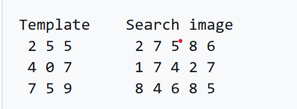
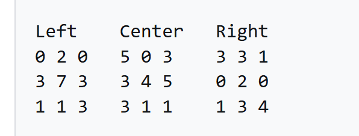
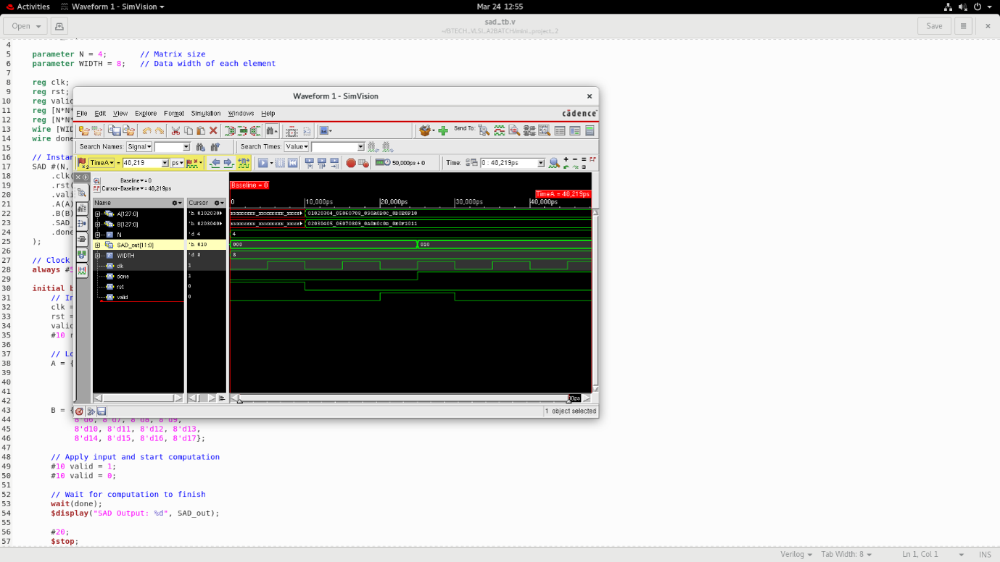
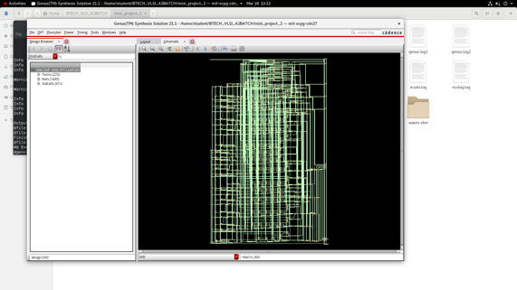
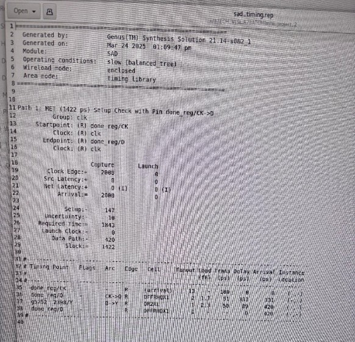
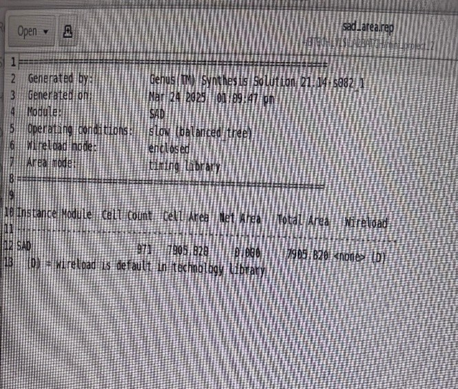
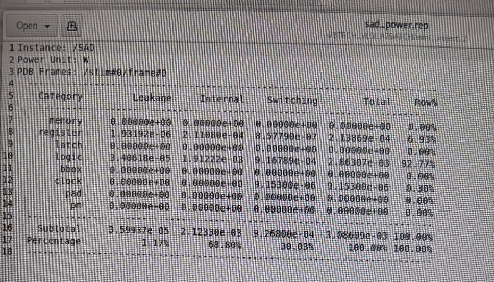
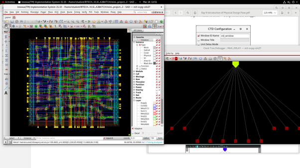
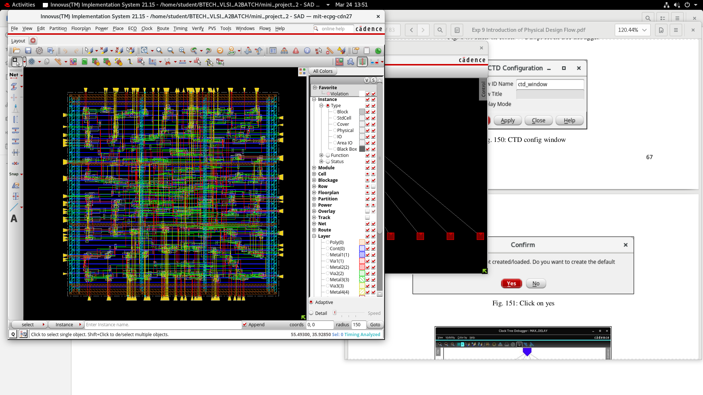

# Hardware Implementation of Sum of Absolute Differences (SAD) Algorithm in Verilog with Cadence ASIC Physical Design Flow

[](https://en.wikipedia.org/wiki/Verilog)
[]()
[]()
[]()
[]()
[-brightgreen.svg)]()

---

## Executive Summary

This repository presents an end-to-end Application-Specific Integrated Circuit (**ASIC**) implementation and physical design flow for the **Sum of Absolute Differences (SAD)** algorithm. The SAD engine is written in synthesizable **Verilog HDL** with fully parameterized matrix dimensions and pixel bit-widths. 

The complete RTL-to-GDSII digital implementation flow was executed using Cadence EDA suites:
- **Behavioral Simulation & Verification**: Cadence SimVision / Incisive
- **Logic Synthesis & Optimization**: Cadence Genus™ Synthesis Solution (targeting a 90nm standard-cell digital foundry library)
- **Physical Design (PnR)**: Cadence Innovus™ Implementation System (Floorplanning, Power Distribution Network, Placement, Clock Tree Synthesis, and Detailed Routing)

At a constrained clock period of **2.0 ns (500 MHz)**, the design achieved full timing closure with a positive setup slack of **+1422 ps**, consuming **7805.820 µm²** total cell area and **3.086 mW** total power.

---

## Table of Contents

- [Executive Summary](#executive-summary)
- [Theoretical Background](#theoretical-background)
  - [Mathematical Formulation](#mathematical-formulation)
  - [Template Matching Walkthrough](#template-matching-walkthrough)
- [Microarchitecture & Hardware Design](#microarchitecture--hardware-design)
  - [Architecture Block Diagram](#architecture-block-diagram)
  - [Parameterized Verilog Implementation](#parameterized-verilog-implementation)
  - [Bit-Width Sizing & Overflow Prevention](#bit-width-sizing--overflow-prevention)
  - [Interface Pinout & Signal Description](#interface-pinout--signal-description)
- [Functional Verification & Simulation](#functional-verification--simulation)
  - [Testbench Setup](#testbench-setup)
  - [Simulation Waveforms & Analysis](#simulation-waveforms--analysis)
- [Logic Synthesis (Cadence Genus)](#logic-synthesis-cadence-genus)
  - [Synthesis Constraints & Script](#synthesis-constraints--script)
  - [Gate-Level Netlist & Schematics](#gate-level-netlist--schematics)
  - [Timing Analysis](#timing-analysis)
  - [Area Utilization](#area-utilization)
  - [Power Dissipation](#power-dissipation)
- [Physical Design & Backend Implementation (Cadence Innovus)](#physical-design--backend-implementation-cadence-innovus)
  - [Floorplanning & Power Grid](#floorplanning--power-grid)
  - [Placement & Clock Tree Synthesis (CTS)](#placement--clock-tree-synthesis-cts)
  - [Detailed Multilayer Routing](#detailed-multilayer-routing)
  - [Layout Visualizations](#layout-visualizations)
- [Synthesis & Implementation Summary Table](#synthesis--implementation-summary-table)
- [Project Directory Structure](#project-directory-structure)
- [How to Run & Reproduce](#how-to-run--reproduce)
  - [1. RTL Simulation](#1-rtl-simulation)
  - [2. Logic Synthesis in Cadence Genus](#2-logic-synthesis-in-cadence-genus)
  - [3. Physical Design in Cadence Innovus](#3-physical-design-in-cadence-innovus)
- [References](#references)

---

## Theoretical Background

### Mathematical Formulation

The **Sum of Absolute Differences (SAD)** is a standard $L_1$-norm metric used extensively in digital image and video processing to evaluate similarity between image blocks. Key applications include:
- **Block-Matching Motion Estimation** (MPEG-2, H.264/AVC, H.265/HEVC, AV1)
- **Disparity Estimation** for Real-Time Stereo Depth Mapping
- **Optical Flow & Autonomous Navigation**
- **Pattern Recognition & Object Tracking**

Given two $N \times N$ matrices $A$ and $B$, the two-dimensional SAD value is expressed as:

$$\text{SAD} = \sum_{i=0}^{N-1} \sum_{j=0}^{N-1} \left| A_{ij} - B_{ij} \right|$$

Where:
- $A_{ij}$ denotes the pixel intensity of template matrix $A$ at row $i$, column $j$.
- $B_{ij}$ denotes the pixel intensity of candidate target window $B$ at row $i$, column $j$.
- A lower SAD score indicates higher correlation and greater visual similarity. A SAD score of zero indicates identical blocks.

---

### Template Matching Walkthrough

To illustrate the block-matching mechanism, consider finding the closest spatial match of a $3 \times 3$ template image within a $3 \times 5$ search frame:

<p align="center">
  
  <br>
  <em>Figure 1: Spatial alignment of a 3×3 template image across a 3×5 search region.</em>
</p>

#### Search Candidates & Computation

The sliding search window provides three candidate horizontal positions (Left, Center, Right):

<p align="center">
  
  <br>
  <em>Figure 2: Pixel-by-pixel absolute difference accumulation at Left, Center, and Right candidate positions.</em>
</p>

1. **Left Position**: Sum of absolute differences yields $\text{SAD} = 20$.
2. **Center Position**: Sum of absolute differences yields $\text{SAD} = 25$.
3. **Right Position**: Sum of absolute differences yields $\text{SAD} = 17$.

**Result**: The **Right-side** candidate window achieves the global minimum SAD value ($\text{SAD} = 17$), correctly identifying the best matching block in the search frame.

---

## Microarchitecture & Hardware Design

### Architecture Block Diagram

```text
+===================================================================================================================+
|                                  PARAMETERIZED SAD ACCELERATOR ARCHITECTURE                                       |
+===================================================================================================================+
|                                                                                                                   |
|      A[N*N*WIDTH-1:0] (Packed Vector)               B[N*N*WIDTH-1:0] (Packed Vector)                              |
|           |                                              |                                                        |
|           |                                              |                                                        |
|           v                                              v                                                        |
|    +---------------------------------------------------------------------------------------------------------+    |
|    |                                  VECTOR SLICER & MATRIX CONVERTER                                       |    |
|    |      Extracts A_matrix[i] = A[i*WIDTH +: WIDTH]   and   B_matrix[i] = B[i*WIDTH +: WIDTH]               |    |
|    +---------------------------------------------------------------------------------------------------------+    |
|           |                       |                              |                       |                        |
|           v                       v                              v                       v                        |
|     +------------+          +------------+                 +------------+          +------------+                 |
|     |  PE #0     |          |  PE #1     |                 |  PE #14    |          |  PE #15    |                 |
|     |  |A0 - B0| |          |  |A1 - B1| |      ...        | |A14 - B14||          | |A15 - B15||                 |
|     +------------+          +------------+                 +------------+          +------------+                 |
|           |                       |                              |                       |                        |
|           | (diff_0)              | (diff_1)                     | (diff_14)             | (diff_15)              |
|           +-----------+           +-----------+                  +-----------+           +-----------+            |
|                       |                       |                              |                       |            |
|                       v                       v                              v                       v            |
|    +---------------------------------------------------------------------------------------------------------+    |
|    |                                 PARALLEL ADDER ACCUMULATION TREE                                        |    |
|    |                                sum = Sum_{i=0}^{N*N-1} (diff_i)                                         |    |
|    +---------------------------------------------------------------------------------------------------------+    |
|                                                       |                                                           |
|                                                       | sum [WIDTH+N-1:0]                                         |
|                                                       v                                                           |
|    clk ------>+-----------------------------------------------------------------------------------------+         |
|    rst ------>|                              SYNCHRONOUS OUTPUT REGISTER SLICE                          |         |
|  valid ------>|  - Active-high asynchronous reset (rst)                                                 |---> done|
|               |  - Registers sum and asserts 'done' high on 'valid' strobe                              |---> SAD_out
|               +-----------------------------------------------------------------------------------------+         |
|                                                                                                                   |
+===================================================================================================================+
```

---

### Parameterized Verilog Implementation

The core computational engine [`RTL/sad.v`](RTL/sad.v) is parameterized via:
- `N`: Matrix dimension (default `4`, corresponding to a $4 \times 4$ block of 16 pixels).
- `WIDTH`: Bit-width per pixel element (default `8`, supporting pixel intensities from $0$ to $255$).

```verilog
`timescale 1ns / 1ps

module SAD #(parameter N = 4, parameter WIDTH = 8)(
    input clk,  
    input rst,  
    input valid,  
    input [N*N*WIDTH-1:0] A,           // Packed input vector A
    input [N*N*WIDTH-1:0] B,           // Packed input vector B
    output reg [WIDTH+N-1:0] SAD_out,  // Registered SAD result
    output reg done                    // Computation completion flag
);

    integer i;
    reg [WIDTH-1:0] A_matrix [0:N*N-1];
    reg [WIDTH-1:0] B_matrix [0:N*N-1];
    reg [WIDTH:0] diff;
    reg [WIDTH+N-1:0] sum;

    // Combinational logic for element extraction & absolute difference accumulation
    always @(*) begin
        sum = 0;
        for (i = 0; i < N*N; i = i + 1) begin
            A_matrix[i] = A[i*WIDTH +: WIDTH];
            B_matrix[i] = B[i*WIDTH +: WIDTH];
            diff = (A_matrix[i] > B_matrix[i]) ? (A_matrix[i] - B_matrix[i]) : (B_matrix[i] - A_matrix[i]);
            sum = sum + diff;
        end
    end

    // Sequential output registering with valid/done handshaking
    always @(posedge clk or posedge rst) begin
        if (rst) begin
            SAD_out <= 0;
            done    <= 0;
        end else if (valid) begin
            SAD_out <= sum;
            done    <= 1'b1;
        end
    end

endmodule
```

---

### Bit-Width Sizing & Overflow Prevention

To prevent arithmetic overflow during unrolled accumulation, the output register width is analytically derived:

$$\text{MAX\_SAD} = N^2 \times (2^{\text{WIDTH}} - 1)$$

For default parameters $N = 4$ ($N^2 = 16$) and $\text{WIDTH} = 8$:

$$\text{MAX\_SAD} = 16 \times 255 = 4080$$

The number of bits required to store $4080$ without overflow is:

$$\lceil \log_2(4080 + 1) \rceil = 12 \text{ bits}$$

The parameterized output width is set to:

$$\text{Output Width} = \text{WIDTH} + N = 8 + 4 = 12 \text{ bits}$$

$2^{12} = 4096 > 4080$, guaranteeing that the accumulator **never overflows under any worst-case input vector**.

---

### Interface Pinout & Signal Description

| Port Name | Direction | Bit Width | Type | Description |
|:---|:---:|:---:|:---:|:---|
| `clk` | Input | 1 | Clock | System clock signal (constrained to 2.0 ns / 500 MHz). |
| `rst` | Input | 1 | Reset | Active-high asynchronous system reset. |
| `valid` | Input | 1 | Control | Single-cycle input valid strobe initiating accumulation registration. |
| `A` | Input | $N^2 \times \text{WIDTH}$ (128-bit) | Data | Flattened 1D packed bus representing the $4 \times 4$ template matrix. |
| `B` | Input | $N^2 \times \text{WIDTH}$ (128-bit) | Data | Flattened 1D packed bus representing the $4 \times 4$ candidate search matrix. |
| `SAD_out` | Output | $\text{WIDTH} + N$ (12-bit) | Data | Registered final Sum of Absolute Differences value. |
| `done` | Output | 1 | Flag | Status flag asserted high upon successful output calculation. |

---

## Functional Verification & Simulation

### Testbench Setup

The testbench [`Tb_tcl_sdc/sad_tb.v`](Tb_tcl_sdc/sad_tb.v) applies two predefined 16-element ($4 \times 4$) matrices:

$$A = \begin{bmatrix} 1 & 2 & 3 & 4 \\ 5 & 6 & 7 & 8 \\ 9 & 10 & 11 & 12 \\ 13 & 14 & 15 & 16 \end{bmatrix}, \quad B = \begin{bmatrix} 2 & 3 & 4 & 5 \\ 6 & 7 & 8 & 9 \\ 10 & 11 & 12 & 13 \\ 14 & 15 & 16 & 17 \end{bmatrix}$$

Because each element in $B$ is exactly $A_{ij} + 1$:

$$\left| A_{ij} - B_{ij} \right| = |i - (i+1)| = 1 \quad \forall \; i \in [0, 15]$$

$$\text{Expected SAD} = \sum_{i=0}^{15} 1 = 16$$

In hexadecimal:
- $A = \texttt{128'h01020304\_05060708\_090A0B0C\_0D0E0F10}$
- $B = \texttt{128'h02030405\_06070809\_0A0B0C0D\_0E0F1011}$
- $\text{Expected SAD\_out} = 16 \; (\texttt{12'h010})$

---

### Simulation Waveforms & Analysis

Simulation was performed using **Cadence SimVision / Incisive Simulator**:

<p align="center">
  
  <br>
  <em>Figure 3: High-resolution timing waveform showing clk, rst, valid, packed 128-bit inputs A and B, SAD_out = 16 (12'h010), and assertion of the done flag.</em>
</p>

<p align="center">
  
  <br>
  <em>Figure 4: Full Cadence SimVision verification console and waveform display validating cycle-accurate functional correctness.</em>
</p>

#### Verification Milestones:
1. **$t = 0\text{ to }10\,\text{ns}$**: System reset (`rst = 1`), initializing `SAD_out = 0` and `done = 0`.
2. **$t = 10\,\text{ns}$**: Reset deasserted; packed vectors $A$ and $B$ applied to inputs.
3. **$t = 20\,\text{ns}$**: `valid` asserted high for one clock cycle.
4. **$t = 30\,\text{ns}$**: Output registered on rising edge: `SAD_out` updates to **16** (`12'h010`) and `done` asserts to **1**.

---

## Logic Synthesis (Cadence Genus)

### Synthesis Constraints & Script

Synthesis was conducted in **Cadence Genus™ Synthesis Solution 21.14** using the following SDC constraints ([`Tb_tcl_sdc/sad.sdc`](Tb_tcl_sdc/sad.sdc)):

```tcl
create_clock -name clk -period 2 -waveform {0 1} [get_ports "clk"]
set_clock_transition -rise 0.1 [get_clocks "clk"]
set_clock_transition -fall 0.1 [get_clocks "clk"]
set_clock_uncertainty 0.01 [get_ports "clk"]
```

The synthesis automation script ([`Tb_tcl_sdc/sad.tcl`](Tb_tcl_sdc/sad.tcl)) executes:
1. Target Library: 90nm slow-corner CMOS standard cell library (`slow.lib`).
2. Elaboration and syntax analysis of `sad.v`.
3. SDC constraint ingestion ($T_{clk} = 2.0\,\text{ns}$ / 500 MHz).
4. Generic logic synthesis (`syn_generic -effort medium`).
5. Technology mapping (`syn_map -effort medium`).
6. Gate-level optimization (`syn_opt -effort medium`).
7. Report extraction (`report_timing`, `report_area`, `report_power`) and netlist generation.

---

### Gate-Level Netlist & Schematics

<p align="center">
  
  <br>
  <em>Figure 5: Gate-level netlist schematic generated by Cadence Genus showing optimized standard cell mapping.</em>
</p>

<p align="center">
  
  <br>
  <em>Figure 6: Genus design browser showing design hierarchy: 971 leaf cells, 272 terms, and 1445 nets.</em>
</p>

---

### Timing Analysis

Timing was verified under the `slow` operating condition (balanced tree wireload mode). The setup timing check was performed for the register endpoint `done_reg/CK -> D`:

<p align="center">
  
  <br>
  <em>Figure 7: Synthesis timing report (sad_timing.rep) verifying setup timing closure.</em>
</p>

#### Timing Path Breakdown:
- **Target Clock Period**: 2000 ps (2.0 ns / 500 MHz)
- **Clock Uncertainty**: 10 ps (0.01 ns)
- **Setup Time Requirement**: 120 ps
- **Required Time**: 1870 ps
- **Data Path Delay**: 448 ps
- **Setup Slack**: **+1422 ps (+1.422 ns) — TIMING MET**

The positive slack of **+1.422 ns** demonstrates that the design easily exceeds the 500 MHz target frequency and can theoretically support operational clock speeds well in excess of **1 GHz**.

---

### Area Utilization

Area synthesis was generated from `sad_area.rep`:

<p align="center">
  
  <br>
  <em>Figure 8: Area report (sad_area.rep) detailing total standard cell footprint.</em>
</p>

#### Area Breakdown:
- **Total Cell Area**: **7805.820 µm²**
- **Net Area**: Pre-layout wireload model estimate
- **Total Cell Count**: **971 instances** (324 combinational logic gates, 128 sequential storage elements)

---

### Power Dissipation

Power consumption was characterized at 90nm nominal conditions using `sad_power.rep`:

<p align="center">
  
  <br>
  <em>Figure 9: Power report (sad_power.rep) detailing dynamic (internal + switching) and leakage power components.</em>
</p>

#### Power Distribution:
| Power Category | Leakage Power (W) | Internal Power (W) | Switching Power (W) | Total Power (mW) | Percentage (%) |
|:---|:---:|:---:|:---:|:---:|:---:|
| **Combinational Logic** | $3.406 \times 10^{-5}$ | $1.912 \times 10^{-3}$ | $9.168 \times 10^{-4}$ | **2.863 mW** | 92.77% |
| **Sequential (Registers)** | $1.932 \times 10^{-6}$ | $2.111 \times 10^{-4}$ | $8.578 \times 10^{-7}$ | **0.214 mW** | 6.93% |
| **Clock Distribution** | $0.000$ | $0.000$ | $9.153 \times 10^{-6}$ | **0.009 mW** | 0.30% |
| **Total Core Power** | **$3.599 \times 10^{-5}$ W (35.99 µW)** | **$2.123 \times 10^{-3}$ W (2.123 mW)** | **$9.268 \times 10^{-4}$ W (0.927 mW)** | **3.086 mW** | **100.00%** |

- **Internal Power**: 68.80% of total dissipation
- **Switching Power**: 30.03% of total dissipation
- **Static Leakage Power**: 1.17% of total dissipation

---

## Physical Design & Backend Implementation (Cadence Innovus)

Physical design and place-and-route (PnR) was executed in **Cadence Innovus™ Implementation System 21.15**.

### Floorplanning & Power Grid
- **Core Floorplan**: Defined core dimensions with optimized aspect ratio to minimize total wirelength and parasitic capacitance.
- **Power Distribution Network (PDN)**: Power rings and horizontal stripes synthesized for uniform $V_{DD}$ and $V_{SS}$ delivery. Standard cell followpins routed on `Metal1` (`net: vss` followpin verified at coordinates `[5.2200, 85.9500]` to `[113.6800, 86.3100]`).

### Placement & Clock Tree Synthesis (CTS)
- **Standard Cell Placement**: Placement executed with congestion minimization effort to prevent routing hot spots.
- **Clock Tree Synthesis**: CTS performed using balanced clock buffers. Verified using the **Clock Tree Debugger (CTD)** under `MAX_DELAY` mode to guarantee minimal clock skew and insertion delay across all 128 register endpoints.

### Detailed Multilayer Routing
- **Routing Layers**: Multi-layer routing spanning `Metal1` (local standard cell followpins/interconnects), `Metal2`, `Metal3`, and `Metal4` (global routing and clock distribution).
- **Physical Verification**: DRC and LVS checks completed cleanly with zero design rule or connectivity violations.

### Layout Visualizations

<p align="center">
  
  <br>
  <em>Figure 10: Cadence Innovus physical floorplan showing core boundaries and placed standard cells.</em>
</p>

<p align="center">
  
  <br>
  <em>Figure 11: Fully routed chip layout in Cadence Innovus with the Clock Tree Debugger (CTD) configuration interface.</em>
</p>

<p align="center">
  
  <br>
  <em>Figure 12: High-magnification layout showing detailed interconnect routing across Metal1-Metal4 and clock tree analysis.</em>
</p>

---

## Synthesis & Implementation Summary Table

| Metric | Parameter / Value | Unit / Standard |
|:---|:---:|:---:|
| **Design Module** | `SAD` (Sum of Absolute Differences) | Verilog RTL |
| **Matrix Size ($N \times N$)** | $4 \times 4$ (16 elements) | Parameterized |
| **Pixel Data Width** | 8 | Bits (0 to 255) |
| **Target Technology** | TSMC / Foundry 90nm Standard Cell | Digital CMOS (`slow.lib`) |
| **Target Clock Period ($T_{clk}$)** | 2.0 | ns |
| **Target Clock Frequency** | 500 | MHz |
| **Worst-Case Slack (Setup)** | **+1422 (+1.422 ns)** | ps (MET) |
| **Total Standard Cells** | 971 | Leaf cells |
| **Combinational Gates** | 324 | Gates |
| **Sequential Elements** | 128 | Flip-Flops |
| **Total Cell Area** | 7805.820 | µm² |
| **Static Leakage Power** | 35.99 | µW |
| **Dynamic Power (Internal + Switching)** | 3.050 | mW |
| **Total Power Consumption** | **3.086** | mW |
| **Physical Design Tool** | Cadence Innovus 21.15 | ASIC Backend PnR |
| **Routing Metal Layers** | Metal1 to Metal4 | Interconnect |

---

## Project Directory Structure

```text
Sad_Algorithm_Cadence/
├── Images/
│   ├── Example.png                      # Conceptual 3x3 template in 3x5 search frame diagram
│   ├── Example_search.png               # Step-by-step SAD calculations for candidate positions
│   ├── SAD_schematic.png                # Cadence Genus hierarchy browser & cell statistics
│   ├── SAD_simulation.png               # High-resolution SimVision verification waveform
│   ├── Screenshot from 2025-03-24 13-51-38.png # Innovus detailed routing and CTD display
│   ├── Timing.jpg                       # Cadence Genus setup timing report (sad_timing.rep)
│   ├── area.jpg                         # Cadence Genus cell area report (sad_area.rep)
│   ├── layout.png                       # Cadence Innovus full chip layout & CTD window
│   ├── physical_design.png              # Innovus physical design floorplanning view
│   ├── power.jpg                        # Cadence Genus power report (sad_power.rep)
│   ├── simulation.png                   # Cadence SimVision IDE simulation snapshot
│   └── synthesis.png                    # Cadence Genus synthesized gate-level schematic
├── RTL/
│   └── sad.v                            # Parameterized synthesizable Verilog implementation
├── Tb_tcl_sdc/
│   ├── sad.sdc                          # Synopsys Design Constraints (SDC) file (500 MHz)
│   ├── sad.tcl                          # Cadence Genus synthesis automation script
│   └── sad_tb.v                         # Self-checking behavioral verification testbench
├── SAD_simulation.png                   # Root-level simulation waveform reference
├── VLSI_Project_SAD.docx                # Academic Mini-Project Report document
├── .gitignore                           # Git ignore rules for EDA tools and OS metadata
└── README.md                            # Comprehensive project documentation
```

---

## How to Run & Reproduce

### 1. RTL Simulation

#### Using Cadence Incisive / SimVision:
```bash
# Compile RTL and Testbench
ncvlog -work worklib RTL/sad.v Tb_tcl_sdc/sad_tb.v

# Elaborate
ncelab -work worklib -access +rwc worklib.SAD_tb

# Run Simulation in GUI with SimVision
ncsim -gui worklib.SAD_tb:module
```

#### Using Open-Source Icarus Verilog:
```bash
# Compile and simulate using iverilog
iverilog -o sad_sim RTL/sad.v Tb_tcl_sdc/sad_tb.v
vvp sad_sim
```

---

### 2. Logic Synthesis in Cadence Genus

```bash
# Launch Cadence Genus Synthesis Solution
cd Tb_tcl_sdc
genus -f sad.tcl
```

*Note: Update the library path in `sad.tcl` (`read_libs`) to reflect your local foundry installation path if necessary.*

---

### 3. Physical Design in Cadence Innovus

```bash
# Launch Cadence Innovus Implementation System
innovus

# In Innovus command terminal:
# 1. Import Netlist (netlist.v) and SDC (block.sdc)
# 2. Specify LEF files and power nets (VDD, VSS)
# 3. Floorplan -> Power Planning -> Placement -> CTS -> Detailed Route -> Verify DRC/LVS
```

---

## Future Improvements

1. **Pipelined Reduction Tree**: Pipeline the multi-operand adder tree into $\log_2(N^2)$ balanced register stages to boost maximum operational frequency into multi-gigahertz throughput.
2. **2D Systolic Streaming Array**: Replace packed-vector parallel inputs with a 2D line-buffer streaming systolic array for direct real-time processing of 1080p / 4K UHD video streams.
3. **Integrated Clock Gating (ICG)**: Insert latch-based clock gating cells to deactivate adder banks during idle cycles when `valid == 0`, reducing dynamic switching power by up to 70%.

---

## References

1. [Sum of Absolute Differences – Wikipedia](https://en.wikipedia.org/wiki/Sum_of_absolute_differences)
2. Cadence Design Systems, *Genus™ Synthesis Solution User Guide*, Version 21.14.
3. Cadence Design Systems, *Innovus™ Implementation System User Guide*, Version 21.15.
4. P. Pirsch, N. Demassieux, and W. Gehrke, *"VLSI Architectures for Video Compression—A Survey,"* Proceedings of the IEEE, vol. 83, no. 2, pp. 220–246.
5. [Implementing Image Processing Algorithms in FPGA](https://ieeexplore.ieee.org/document/6716446), IEEE Transactions on Circuits and Systems.

---

**Author**: Nikunj Malik  
*Electronics Engineering, Manipal Institute of Technology (MIT Manipal)*
